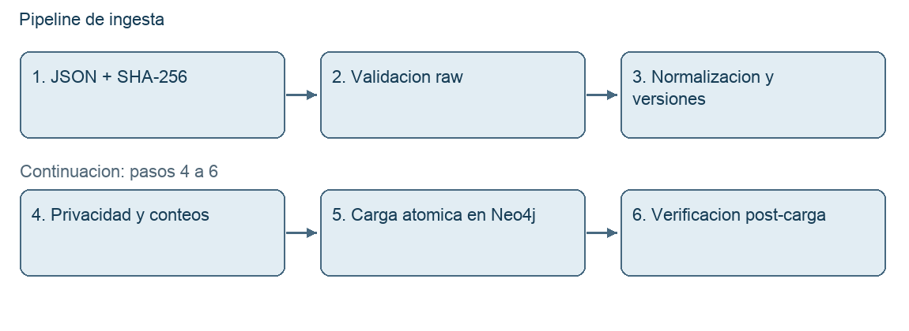
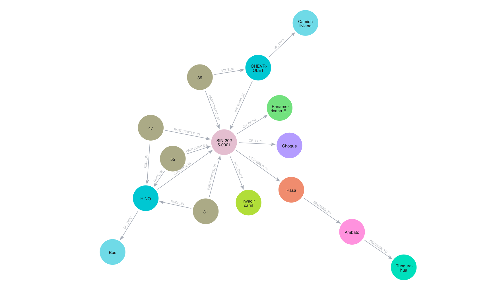
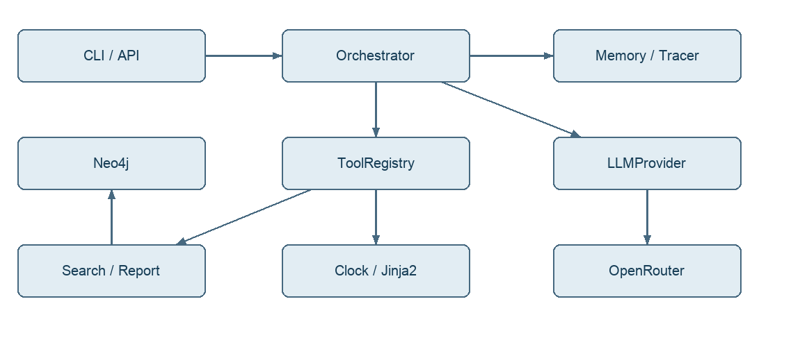
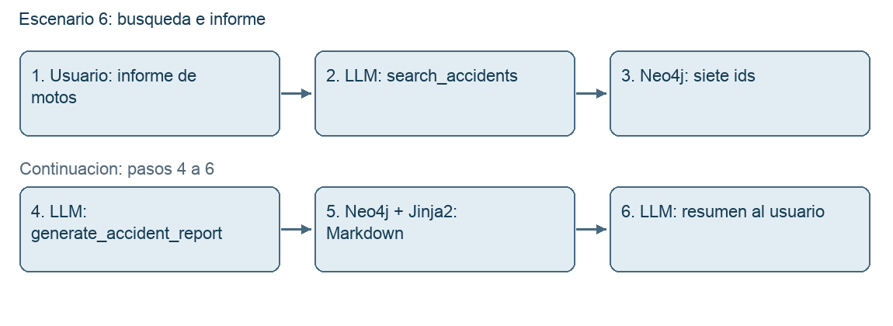
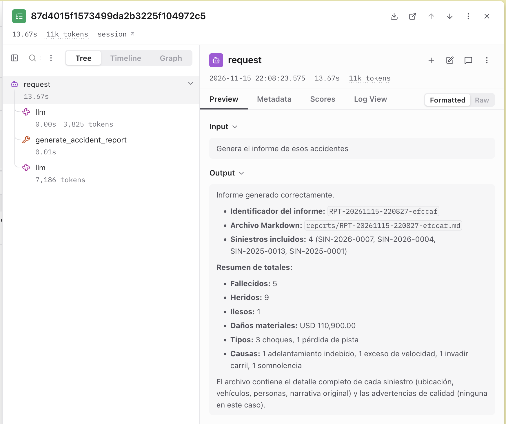
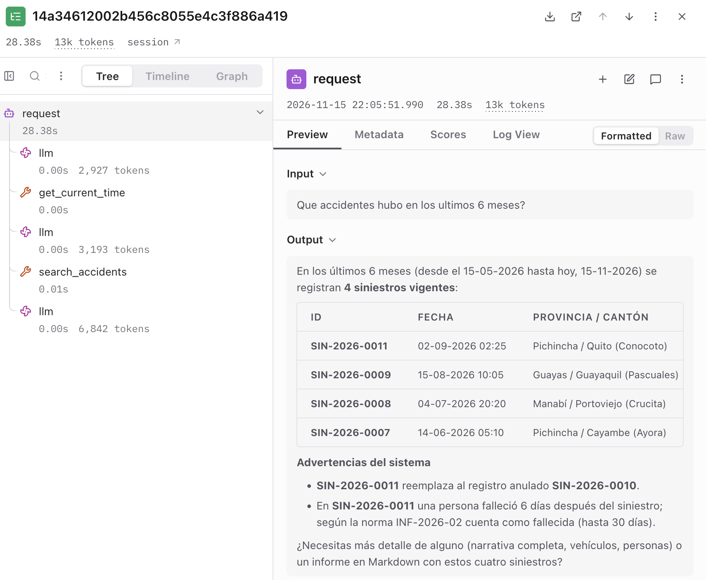
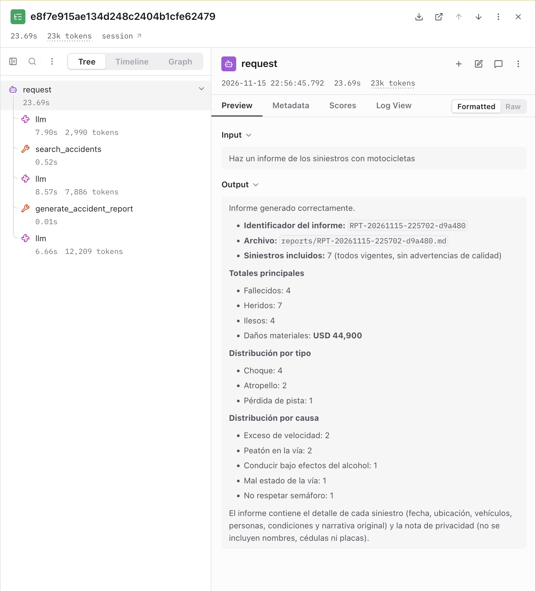
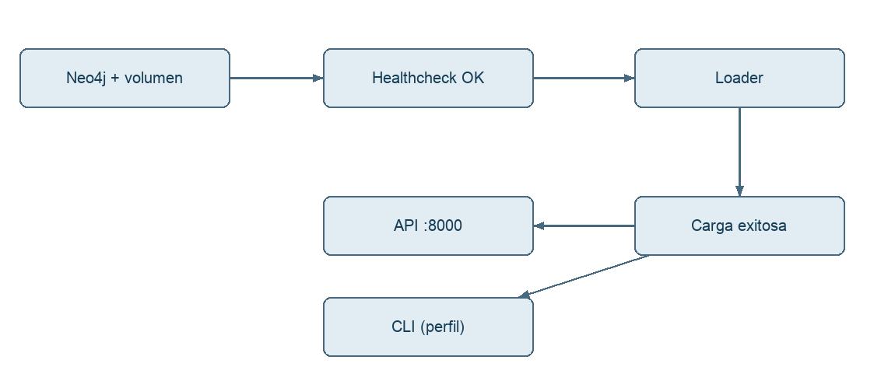

# Documento técnico

Orquestador multiagente con RAG sobre Neo4j - Prueba técnica BIT

Autor: J0hnFe (identidad del historial Git). Versión documental: 1.1, 16 de noviembre de 2026.

Repositorio público: https://github.com/J0hnFe/accident-agent

Referencia de entrega: tag `entrega-1.0`. Implementación descrita: commit `ecea903`, versión de aplicación 0.1.0; los commits posteriores solo modifican documentación y evidencias.


Contenido: 1. Resumen ejecutivo | 2. Alcance y trazabilidad | 3. Análisis de datos | 4. Normalización e ingesta | 5. Modelo de grafo | 6. Arquitectura y SOLID | 7. Orquestador y memoria | 8. Herramientas y contratos | 9. Recuperación de hechos (RAG) | 10. Proveedor de IA | 11. Observabilidad | 12. Seguridad y privacidad | 13. Infraestructura y reproducibilidad | 14. Pruebas y resultados | 15. Limitaciones y evolución | 16. Anexos y registro de decisiones.


| Versión | Fecha | Cambios |
| --- | --- | --- |
| 1.0 | 2026-11-15 | Primera edición basada en etapas 0 a 5; entrega externa pendiente |
| 1.1 | 2026-11-16 | Repositorio público, referencia de entrega, capturas de Langfuse de los escenarios 4 a 6 y revisión final |

## 1. Resumen ejecutivo

El sistema responde preguntas sobre siniestros de tránsito del Ecuador, consulta la hora y genera informes verificables. Un orquestador propio coordina tres herramientas mediante function calling. Las interfaces CLI y REST comparten los mismos contratos y servicios. Neo4j contiene los hechos; el modelo interpreta la pregunta y redacta la respuesta, pero no escribe consultas Cypher libres.

La solución usa Python 3.12, Pydantic, Neo4j, HTTPX y OpenRouter. Las consultas parametrizadas reducen la superficie de errores y la generación de informes con Jinja2 evita introducir hechos nuevos. Los datos ficticios contienen 31 registros y cinco informes; tras normalización hay 30 siniestros únicos, 29 vigentes y cuatro informes públicos. Los vigentes suman 18 fallecidos y 44 heridos.

La etapa 5 registró 748 pruebas aprobadas y una prueba real omitida por cuota agotada, con cobertura total del 97%. Este resultado histórico está conservado en `docs/evidencias/5.9_pytest_cobertura.txt`. Las comprobaciones nuevas se registran por separado en la etapa 6. Para instalar, completar `.env` según el README y ejecutar `docker compose up -d --build`.

## 2. Alcance y trazabilidad

| Requisito | Implementación | Evidencia |
| --- | --- | --- |
| Analizar y limpiar el JSON por código | Modelos raw, normalizadores y pipeline | `docs/datos/`, evidencia 1.10 |
| Grafo justificado y carga reproducible | Neo4j, restricciones, loader y Compose | `docs/modelo_grafo.md`, evidencia 2.6 |
| Tres herramientas con contratos | Tool y modelos Pydantic | `tests/unit/test_tool_base.py`, evidencia 3.7 |
| Orquestación y seguimiento | Ciclo limitado, memoria por sesión | Escenarios 3 a 6 y prueba OCP |
| Fallos y observabilidad | Envolturas, JSONL y Tracer | Evidencias 4.11 y 5.3 |
| Privacidad y consultas seguras | DTOs, exclusiones y execute_read | Evidencias 5.4 y 5.6 |
| Documentos y repositorio público | README y documentos de entrega | https://github.com/J0hnFe/accident-agent, acceso anónimo verificado (evidencia 6.4) |

No se incluyen interfaz gráfica, embeddings, autenticación ni sesiones persistentes. Cada requisito del enunciado se contrastó con su evidencia antes de la entrega. La evidencia está inventariada en las notas de las etapas 0 a 6 (`docs/evidencias/`).

## 3. Análisis de datos

La fuente es un extracto ficticio ANT / ECU 911, con metadata de zona `America/Guayaquil` y fechas día primero. Las 30 anomalías catalogadas incluyen cuatro formatos de fecha, montos numéricos y textuales, doce variantes de protección, alias de vías y categorías con distinta capitalización. El diccionario de campos, tipos observados, valores faltantes y decisiones completas está en `docs/datos/analisis_datos.md` y `catalogo_anomalias.md`.

| Campo o caso | Entrada observada | Tratamiento |
| --- | --- | --- |
| Fecha | `03/02/2025 22:15` | Fecha local día primero, con UTC-05:00 |
| Daños USD | `21.000,00 USD` | 21000.0 |
| Kilómetro | `12+000` | 12.0 |
| Alcoholemia | `N/D`, vacío o null | Ausencia de dato, nunca cero inventado |
| Protección | `CINTURON`, `SI - CASCO` | Catálogos canónicos |
| SIN-2025-0007 | Versiones 1 y 2 | Versión 2; daños 4100; versions_count=2 |
| SIN-2025-0012 | Resumen dice 3 heridos | Personas indican 2; advertencia de discrepancia |
| SIN-2026-0010 | Anulado | Conservar y enlazar con SIN-2026-0011 |
| Fallecimiento diferido | Seis días después | Fallecido dentro del umbral de 30 días |

Cinco peatones no tienen vehículo asociado. No se fuerza esa relación. Los identificadores de personas y vehículos son sintéticos por siniestro, sin vincular identidades entre accidentes. `INF-2026-02` aporta el diccionario; `INF-2026-01` reemplaza a `INF-2025-01`. `INF-RES-01` se excluye por completo. La narrativa de `SIN-2026-0009` contiene una instrucción maliciosa y se trata como dato no confiable.

## 4. Normalización e ingesta

El flujo es lectura y verificación SHA-256, validación raw permisiva, normalización, selección de última versión, conservación de anulados, recálculo de víctimas desde personas, eliminación de datos personales, escritura y verificación. Las reglas exactas están en `docs/datos/reglas_normalizacion.md`; las anomalías se reportan sin alterar el original.

El volumen de datos se monta en solo lectura. El escritor realiza una carga atómica e idempotente y crea restricciones e índices. La verificación posterior consulta etiquetas, relaciones, full-text y privacidad; los valores de control específicos se exigen solo cuando el SHA-256 corresponde al dataset conocido. Véanse `ingestion/neo4j_writer.py`, `verification.py` y la salida real `2.6_salida_loader.txt`.



## 5. Modelo de grafo

Accident es la entidad central. Province, Canton y Parish forman una jerarquía geográfica; Road, AccidentType y Cause permiten compartir dimensiones y agregar resultados. Vehicle y Person son participantes; VehicleType clasifica vehículos. Report y ReportSection separan el informe y su texto indexado. Dataset conserva la procedencia. El inventario completo de claves y propiedades está en `docs/modelo_grafo.md`.

| Origen | Relación | Destino |
| --- | --- | --- |
| Accident | OCCURRED_IN | Parish |
| Parish / Canton | BELONGS_TO | Canton / Province |
| Accident | ON_ROAD / OF_TYPE / HAS_CAUSE | Road / AccidentType / Cause |
| Vehicle | INVOLVED_IN / OF_TYPE | Accident / VehicleType |
| Person | PARTICIPATED_IN / RODE_IN | Accident / Vehicle |
| Accident | REPLACED_BY | Accident |
| Report | SUPERSEDES / ANALYZES_ROAD / HAS_SECTION | Report / Road / ReportSection |

Clima, superficie e iluminación se mantienen como propiedades: no tienen atributos propios y añadir nodos produciría saltos innecesarios. Las claves de cantón y parroquia son compuestas para evitar homónimos. Hay restricciones de unicidad, índices temporales y de actividad, y full-text sobre copias normalizadas sin tildes. Los textos originales permanecen disponibles para presentación.

Las consultas ejecutadas de `2.8_consultas_ejemplo.txt` prueban: Pichincha y Guayas tienen cinco vigentes cada una; la E35 tiene cuatro accidentes con fallecidos; siete vigentes involucran motocicletas; los últimos seis meses desde 2026-11-15 contienen cuatro siniestros; SIN-2026-0010 apunta a SIN-2026-0011. El código Cypher correspondiente está en la sección 9 del modelo y en `tests/integration/example_queries.py`.



## 6. Arquitectura y SOLID

La arquitectura de puertos y adaptadores mantiene el núcleo independiente de FastAPI, Typer, HTTPX y el driver Neo4j. `bootstrap.py` construye dependencias y registra herramientas. Los puertos son Tool, LLMProvider, AccidentRepository, ConversationMemory, Clock y Tracer.

| Principio | Aplicación concreta |
| --- | --- |
| Responsabilidad única | Orchestrator coordina; Neo4jAccidentRepository consulta; normalizers limpia |
| Abierto/cerrado | ToolRegistry registra herramientas nuevas; prueba OCP sin modificar el ciclo |
| Sustitución | FakeLLMProvider y OpenRouterProvider cumplen el mismo contrato |
| Interfaces pequeñas | Clock ofrece el reloj; Tracer encapsula observabilidad |
| Inversión | El núcleo recibe puertos; bootstrap elige adaptadores |

Para añadir una herramienta: definir entrada y salida Pydantic, implementar Tool.run, fijar nombre/descripción/timeout, registrar en bootstrap y probar contrato y ejecución. El esquema se genera del modelo, sin mantener una segunda definición manual. La prueba de extensión está en `tests/unit/test_orchestrator.py`.

LangGraph se descartó porque el ciclo es pequeño y agregaría dependencias sin sustituir los contratos propios. Text2Cypher se descartó para limitar las consultas a plantillas comprobables. Los embeddings quedaron fuera de alcance: los filtros y full-text cubren los escenarios. HTTPX facilita controlar reintentos y fallos sin acoplar el núcleo a un SDK del proveedor.



## 7. Orquestador y memoria

Cada solicitud recibe trace_id. El ciclo prepara prompt, historial y últimos identificadores; llama al proveedor; valida y ejecuta herramientas; devuelve sus resultados al modelo y repite hasta respuesta final o límite. Las llamadas independientes del mismo turno se ejecutan en paralelo en un ThreadPoolExecutor de ocho hilos; los resultados se recopilan en el orden solicitado. Las dependencias entre búsqueda e informe requieren observar primero el resultado de búsqueda.

El escenario 6 sigue esta secuencia: usuario solicita informe de motocicletas, LLM selecciona search_accidents, repositorio consulta Neo4j, resultado devuelve siete ids, LLM selecciona generate_accident_report, herramienta vuelve a consultar hechos, genera Markdown y LLM resume la entrega. El informe nunca usa como fuente los números escritos por el modelo.

| Control | Valor inicial | Motivo |
| --- | --- | --- |
| Iteraciones | 5 | Evitar ciclos ilimitados |
| Llamadas por iteración | 4 | Limitar trabajo solicitado por el modelo |
| Timeout LLM | 30 s | Acotar espera de red |
| Hora / búsqueda / informe | 2 / 10 / 15 s | Ajustar al trabajo de cada herramienta |
| Historial | 10 turnos | Mantener contexto y limitar consumo |

Las sesiones viven en memoria. `last_accident_ids` permite resolver «esos accidentes». Reiniciar elimina contexto; la API requiere un solo worker. `stop_reason` distingue final_answer, max_iterations y llm_error. Las herramientas devuelven éxito con data o error con type y message; validation, timeout, execution y not_found son categorías del contrato.

El prompt exige hechos recuperados y citas por id, rechaza solicitudes de datos personales y pide consultar el reloj antes de interpretar fechas relativas. Los resultados se delimitan con `resultado_herramienta`; los signos de apertura y cierre dentro del JSON se escapan. La guardia de grounding acepta ids recuperados, recordados en la sesión o presentes en la pregunta; advierte otros ids y registra el incidente, pero no demuestra que cada cifra sea correcta.



## 8. Herramientas y contratos

Tool publica name, description, input_model, output_model, timeout_seconds y run. Pydantic rechaza entradas fuera del contrato y valida salidas antes de devolverlas al modelo.

| Herramienta | Entrada | Salida principal |
| --- | --- | --- |
| get_current_time | timezone IANA opcional, hasta 64 caracteres | Fecha, hora, día, offset, ISO y timestamp |
| search_accidents | mode, filtros, group_by, limit | total_found, accidents/stats/reports, applied_filters, warnings |
| generate_accident_report | 1 a 20 ids, título opcional, include_narrative, save_file | report_id, contenido, ruta, incluidos, no encontrados y advertencias |

search_accidents acepta accident_ids (hasta 20), province, canton (80 caracteres), road (120), accident_type, cause, weather, surface, lighting, vehicle_type, date_from/date_to inclusivas, only_fatal, text (200), include_annulled y limit (1 a 50, inicial 10). Las fechas deben estar ordenadas. mode=stats exige group_by: province, cause, accident_type, month, year, weather o vehicle_type. Un siniestro puede contarse en varios grupos de vehículo.

mode=reports usa texto y código de vía; advierte sobre filtros de siniestro ignorados. Los ids explícitos permiten consultar anulados. El valor canónico desconocido produce validación con sugerencias, sin interpolarse en Cypher.

El informe acepta título de hasta 120 caracteres; include_narrative y save_file son verdaderos por defecto. Deduplica ids, excluye anulados de totales y reporta faltantes. Si no encuentra ninguno, devuelve contenido vacío y report_id nulo. Si no puede escribir el archivo, conserva content_markdown y advierte. El id tiene formato RPT-AAAAMMDD-HHMMSS-hash.

Ejemplos reales completos de las tres herramientas: `docs/evidencias/3.7_ejemplos_herramientas.md`. El anexo incluye un informe completo. El contrato detallado ejecutable está en los modelos de `tools/`, evitando divergencias entre documentación y JSON Schema.

## 9. Recuperación de hechos (RAG)

La pregunta se transforma en filtros validados; estos se normalizan con los mismos catálogos de ingesta; el repositorio selecciona una plantilla Cypher parametrizada, obtiene DTOs sin campos personales y los devuelve con advertencias. El LLM redacta a partir de esos resultados. Las narrativas y secciones documentales permiten búsqueda léxica full-text, con escape de sintaxis Lucene y copias sin tildes.

Los anulados se excluyen por defecto; los informes vigentes tienen prioridad sobre reemplazados. Cero resultados produce una advertencia explícita y no habilita al modelo a completar desde Internet. Los escenarios 3, 7, 8 y 10 verifican recuperación, inyección, prioridad documental y ausencia de datos.

## 10. Proveedor de IA

OpenRouter se adapta mediante LLMProvider. El modelo principal configurado es `nvidia/nemotron-3-ultra-550b-a55b:free`; respaldos: `nvidia/nemotron-3.5-super-vl:free` y `google/gemma-4-31b-it:free`. Son las selecciones verificadas durante la etapa 0, no una garantía de disponibilidad futura. El adaptador convierte esquemas y tool_calls, aplica timeout, reintentos con backoff y Retry-After, y entrega errores tipados.

Las verificaciones fechadas de cuota están en `0.3_limites_openrouter.md`: se observó un límite de 50 solicitudes diarias sin créditos y 20 por minuto. Las cifras describen aquella cuenta y ejecución. En la etapa 5 se agotó la cuota; probar otros modelos no evita un límite de cuenta. Las pruebas habituales usan FakeLLMProvider, sin consumo. Un turno suele requerir dos o tres llamadas; la evidencia real registró latencias de 2.6 a 51.2 segundos por solicitud.

Cambiar proveedor requiere implementar LLMProvider y seleccionar el adaptador en bootstrap, sin modificar herramientas ni orquestador. La configuración se toma de variables de entorno; nunca se fija una clave en código.

## 11. Observabilidad

structlog emite eventos JSON tool_call, llm_call y request, correlacionados con trace_id, duración, parámetros, estado y errores. En CLI los logs van a archivo para no contaminar la conversación; la API también puede emitirlos a stdout. El ejemplo íntegro está en `4.11_logs_solicitud.jsonl`.

Tracer abstrae Langfuse. Sin ambas claves se selecciona NoopTracer; SafeTracer evita que una caída del servicio de trazas interrumpa la respuesta. Logs y trazas pasan por redacción. Las trazas registran solicitudes, spans de herramientas y generations de LLM. Las capturas siguientes muestran el árbol de las trazas de los escenarios 4, 5 y 6: un span por herramienta y una generation por llamada al modelo, con tokens y latencia total. En los escenarios 4 y 5, registrados antes de corregir la medición de las generations, cada llamada al modelo figura con unos 0 s; la duración total de la traza es correcta. El escenario 6 mide cada llamada: 7,9 s, 8,6 s y 6,7 s, que con las herramientas suman los 23,7 s de la solicitud. El detalle textual está en `5.2_langfuse_escenarios_4_5_6.txt`.







## 12. Seguridad y privacidad

Nombres, cédulas y placas del dataset no se cargan en el grafo; INF-RES-01 se excluye incluso como texto. Los DTOs exponen campos permitidos. La prueba de inyección incluye el intento de cerrar delimitadores. Las 13 plantillas consultadas por el repositorio se verificaron con EXPLAIN como lectura, además del rechazo de escritura bajo execute_read.

La evidencia 5.4 encontró cero coincidencias de la nómina en 47 archivos y 150 observaciones de Langfuse; los patrones genéricos tuvieron falsos positivos revisados. La evidencia 5.6 verificó ocho commits sin secretos; antes de publicar, la evidencia 6.4 repitió gitleaks sobre el historial completo (diez commits) y buscó literalmente las claves del `.env` local, sin coincidencias. Estos resultados no son una auditoría automática de modificaciones futuras; el hook de gitleaks revisa cada commit nuevo.

El JSON original se distribuye por decisión documentada del candidato y contiene información ficticia; la exclusión del grafo no elimina ese contenido del archivo fuente. OpenRouter recibe mensajes y hechos recuperados. No se garantiza redacción de datos personales escritos por el usuario en el mensaje ni en la respuesta del modelo; sí en logs y trazas. Edad exacta, fecha y lugar conservan riesgo de reidentificación si se sustituyera el dataset por datos reales.

## 13. Infraestructura y reproducibilidad

Compose inicia Neo4j 5.26.31-community, espera su healthcheck, ejecuta loader una vez y arranca API solo si la carga termina correctamente. CLI se activa mediante perfil. Los puertos se publican en localhost. El volumen neo4j_data conserva la base; informes y logs dentro de los contenedores no tienen volumen y deben copiarse o montarse si se desean conservar.

Python 3.12 se gestiona con uv. pyproject fija versiones, uv.lock congela resolución y requirements.txt permite instalación pip. El README documenta todas las variables: conexión Neo4j, modelos y clave OpenRouter, claves opcionales Langfuse, límites, zona horaria y rutas. El arranque limpio histórico tardó 12 segundos; el build sin caché, cinco. No son una promesa de rendimiento en otro equipo.



## 14. Pruebas y resultados

Las unitarias aíslan reglas y errores; las de contrato comparan fake y repositorio; integración verifica Neo4j; los escenarios de conversación usan un proveedor guionizado y reloj fijo. La prueba e2e real es optativa y depende de cuota. El README distingue los comandos para evitar consumo accidental.

| Escenarios | Resultado registrado |
| --- | --- |
| 1 a 3: hora, Pichincha y E35 | Hora sin grafo; cinco y cuatro siniestros respectivamente |
| 4 a 6: seguimiento, fechas relativas e informe | Memoria, reloj previo y siete motocicletas |
| 7 a 9: privacidad, informe vigente y definición | Sin PII; fuentes documentales correctas |
| 10 a 13: vacío, id inexistente, anulado y fuera de alcance | Avisos y ausencia de hechos inventados |
| 14 a 17: base caída, proveedor, timeout y límite | Fallos controlados; proceso continúa |

Con Neo4j detenido, search_accidents devuelve un error de servicio no disponible en un máximo medido de 3,5 s, antes de su timeout de 10 s; el modelo lo explica al usuario y GET /health informa `degraded`. Ante un 429, el adaptador reintenta con backoff y Retry-After, prueba los modelos de respaldo y, si todos fallan, la respuesta termina con stop_reason=llm_error y un mensaje de límite de uso. Una herramienta que supera su timeout devuelve un error de tipo timeout al modelo y el ciclo continúa. Los mensajes reales de cada caso están en `func_5.3_mensajes_error.md` y en el anexo del documento funcional.

La etapa 5 registra 719 pruebas por defecto y 29 de integración aprobadas, una real omitida y 97% de cobertura total. Core alcanza 99% y tools 98%. Ruff y mypy pasaron en esa etapa. Los defectos corregidos fueron latencia excesiva de reintentos Neo4j, envío de mensajes CLI vacíos, texto engañoso ante cuota diaria y cobertura incompleta de SafeTracer. El detalle y las pruebas están en `etapa-5_notas.md`.

## 15. Limitaciones y evolución

Las sesiones no sobreviven reinicios y no se comparten entre workers. La API carece de autenticación y control de consumo. El full-text no resuelve sinónimos como una búsqueda semántica. Los modelos gratuitos pueden retirarse; los respaldos comparten cuota. Los datos llegan solo hasta 2026-09-02, las coordenadas son referenciales y no cubren todo Ecuador.

Un timeout externo no cancela un hilo Python que ya corre; los timeouts nativos acotan su duración. La guardia de ids no verifica afirmaciones sin ids. Los informes pueden perderse al recrear contenedores y su identificador determinista dentro de un mismo segundo no garantiza unicidad de variantes de título.

Mejoras posibles: persistencia de sesiones e informes, autenticación, verificación numérica, búsqueda híbrida, segundo proveedor e integración continua. No se añaden a la implementación porque exceden el alcance acordado.

## 16. Anexos y registro de decisiones

Las fuentes completas son `docs/datos/analisis_datos.md`, `reglas_normalizacion.md`, `reporte_calidad_datos.md`, `docs/modelo_grafo.md` y las notas de cada etapa. Los contratos ejecutables están en `src/accident_agent/tools/`. El glosario: RAG significa recuperar hechos antes de generar; DTO es un objeto de transferencia; puerto es el contrato propio y adaptador su implementación; grounding es el vínculo entre respuesta y hechos recuperados.

La entrega incluye las fuentes Markdown y exportaciones PDF. Se eligió PDF por su lectura sin dependencias de editor. El repositorio se publicó en https://github.com/J0hnFe/accident-agent y su acceso anónimo se verificó el 16 de noviembre de 2026 (`docs/evidencias/6.4_acceso_anonimo_github.png`).

### Consultas Cypher reproducidas del modelo

```cypher
MATCH (a:Accident {is_active: true})-[:OCCURRED_IN]->(:Parish)-[:BELONGS_TO]->(:Canton)
      -[:BELONGS_TO]->(p:Province)
RETURN p.name AS province, count(a) AS accidents
ORDER BY accidents DESC, province
```

```cypher
MATCH (a:Accident {is_active: true})-[r:ON_ROAD]->(road:Road {code: $road_code})
WHERE a.deaths > 0
RETURN a.accident_id, a.date, a.deaths, r.km
ORDER BY a.date
```

```cypher
MATCH (a:Accident {is_active: true})<-[:INVOLVED_IN]-(:Vehicle)-[:OF_TYPE]->(:VehicleType {code: $vehicle_type})
RETURN count(DISTINCT a) AS accidents
```

Resultados históricos correspondientes: Guayas y Pichincha, cinco vigentes cada una; cuatro siniestros con fallecidos en la E35; siete con motocicletas. Parámetros y salidas están en 2.8_consultas_ejemplo.txt.

### Contratos: ejemplos reales

Entrada de `get_current_time` (sin parámetros):

```json
{}
```

Salida:

```json
{
  "ok": true,
  "data": {
    "iso_datetime": "2026-11-15T21:48:39-05:00",
    "date": "2026-11-15",
    "time": "21:48:39",
    "weekday": "domingo",
    "timezone": "America/Guayaquil",
    "utc_offset": "-05:00",
    "unix_timestamp": 1794797319
  }
}
```

Entrada de `search_accidents`:

```json
{
  "province": "pichincha"
}
```

Salida, recortada a un siniestro; el total se conserva.

```json
{
  "ok": true,
  "data": {
    "mode": "search",
    "total_found": 5,
    "accidents": [
      {
        "accident_id": "SIN-2026-0011",
        "date": "2026-09-02",
        "status": "vigente",
        "province": "Pichincha",
        "canton": "Quito",
        "road_code": null,
        "accident_type": "choque",
        "cause": "exceso_de_velocidad",
        "deaths": 2,
        "injured": 1,
        "replaced_by": null
      }
    ],
    "stats": [],
    "reports": [],
    "applied_filters": {
      "mode": "search",
      "limit": 10,
      "province": "Pichincha"
    },
    "warnings": [
      "SIN-2026-0011 reemplaza al registro anulado SIN-2026-0010.",
      "SIN-2026-0011: una persona fallecio 6 dias despues del siniestro; cuenta como fallecida (hasta 30 dias, INF-2026-02)."
    ]
  }
}
```


### Logs reales de una solicitud completa

Fuente: 4.11_logs_solicitud.jsonl. Se cambia únicamente la sangría para legibilidad.

```json
{
  "trace_id": "87d4015f1573499da2b3225f104972c5",
  "session_id": "19be68f24ce1473a8b446e8845bb0325",
  "iteration": 1,
  "status": "ok",
  "model": "nvidia/nemotron-3-ultra-550b-a55b:free",
  "duration_ms": 3598,
  "tokens": {
    "prompt_tokens": 3631,
    "completion_tokens": 194,
    "total_tokens": 3825
  },
  "retries": 0,
  "tool_calls": [
    "generate_accident_report"
  ],
  "event": "llm_call",
  "level": "info",
  "timestamp": "2026-11-16T03:08:27.176065Z"
}
```

```json
{
  "trace_id": "87d4015f1573499da2b3225f104972c5",
  "session_id": "19be68f24ce1473a8b446e8845bb0325",
  "iteration": 1,
  "tool": "generate_accident_report",
  "params": {
    "accident_ids": [
      "SIN-2026-0007",
      "SIN-2026-0004",
      "SIN-2025-0013",
      "SIN-2025-0001"
    ],
    "include_narrative": true,
    "save_file": true
  },
  "duration_ms": 11,
  "status": "ok",
  "result_summary": {
    "report_id": "RPT-20261115-220827-efccaf",
    "file_path": "reports/RPT-20261115-220827-efccaf.md",
    "accident_ids": [
      "SIN-2026-0007",
      "SIN-2026-0004",
      "SIN-2025-0013",
      "SIN-2025-0001"
    ]
  },
  "error_type": null,
  "event": "tool_call",
  "level": "info",
  "timestamp": "2026-11-16T03:08:27.189710Z"
}
```

```json
{
  "trace_id": "87d4015f1573499da2b3225f104972c5",
  "session_id": "19be68f24ce1473a8b446e8845bb0325",
  "iteration": 2,
  "status": "ok",
  "model": "nvidia/nemotron-3-ultra-550b-a55b:free",
  "duration_ms": 10049,
  "tokens": {
    "prompt_tokens": 6787,
    "completion_tokens": 399,
    "total_tokens": 7186
  },
  "retries": 0,
  "tool_calls": [],
  "event": "llm_call",
  "level": "info",
  "timestamp": "2026-11-16T03:08:37.239380Z"
}
```

```json
{
  "trace_id": "87d4015f1573499da2b3225f104972c5",
  "session_id": "19be68f24ce1473a8b446e8845bb0325",
  "iterations": 2,
  "stop_reason": "final_answer",
  "tools": [
    "generate_accident_report"
  ],
  "duration_ms": 13667,
  "event": "request",
  "level": "info",
  "timestamp": "2026-11-16T03:08:37.243298Z"
}
```


### Informe completo generado

Salida real de `generate_accident_report` con los cuatro siniestros con fallecidos de la E35, generada el 15 de noviembre de 2026 contra el Neo4j de Docker Compose durante la tarea 3.7. Es el mismo conjunto que usa el seguimiento del escenario 4; el identificador difiere porque cada ejecución crea un informe nuevo. El texto del informe se reproduce sin cambios: las etiquetas de la plantilla se escriben sin tildes y las narrativas conservan el texto original de los partes.

#### Informe de 4 siniestros

- **Identificador:** RPT-20261115-214839-ce0d8a
- **Generado:** 2026-11-15 21:48 (America/Guayaquil)
- **Fuente:** Extracto ficticio de partes de siniestros de tránsito (ANT / ECU 911) - SOLO PARA PRUEBA TÉCNICA (archivo `siniestros_raw.json`, SHA-256 `77e2ca6e3f29`, extracto del 2026-11-09)
- **Siniestros incluidos:** 4

Todos los datos de este informe se consultaron en la base de siniestros al generarlo.

##### Resumen

| Indicador | Valor |
| --- | --- |
| Siniestros vigentes | 4 |
| Fallecidos | 5 |
| Heridos | 9 |
| Ilesos | 1 |
| Danos materiales (USD) | 110,900.00 |

###### Por tipo de siniestro

| Tipo | Siniestros |
| --- | --- |
| Choque | 3 |
| Perdida de pista | 1 |

###### Por causa

| Causa | Siniestros |
| --- | --- |
| Adelantamiento indebido | 1 |
| Exceso de velocidad | 1 |
| Invadir carril | 1 |
| Somnolencia | 1 |

##### Detalle por siniestro

###### SIN-2025-0001 - 2025-01-12 05:40

- **Ubicacion:** Pasa, Ambato, Tungurahua
- **Via:** Panamericana E35 (Troncal de la Sierra) (E35), km 128.0
- **Tipo y causa:** Choque; Invadir carril
- **Condiciones:** clima neblina, superficie humeda, iluminacion amanecer atardecer
- **Victimas:** 1 fallecidos, 3 heridos, 0 ilesos
- **Danos materiales (USD):** 18,500.00

| Vehiculo | Tipo | Marca y modelo | Anio | Servicio |
| --- | --- | --- | --- | --- |
| SIN-2025-0001-V1 | Bus | HINO AK | 2018 | Publico |
| SIN-2025-0001-V2 | Camion liviano | CHEVROLET NKR | 2015 | Carga |

| Persona | Rol | Edad | Sexo | Condicion | Proteccion | Alcoholemia (g/L) | Vehiculo |
| --- | --- | --- | --- | --- | --- | --- | --- |
| SIN-2025-0001-P1 | Conductor | 47 | M | Herido leve | Cinturon | 0.0 | SIN-2025-0001-V1 |
| SIN-2025-0001-P2 | Pasajero | 31 | F | Herido leve | No registrado | sin dato | SIN-2025-0001-V1 |
| SIN-2025-0001-P3 | Pasajero | 55 | M | Herido grave | No registrado | sin dato | SIN-2025-0001-V1 |
| SIN-2025-0001-P4 | Conductor | 39 | M | Fallecido | Cinturon | 0.0 | SIN-2025-0001-V2 |

Narrativa del parte (texto original):

> Un bus interprovincial que cubría la ruta Quito-Riobamba invadió el carril contrario por neblina densa y colisionó contra un camión liviano. El conductor del camión falleció en el lugar; el conductor del bus y dos pasajeros resultaron heridos.

###### SIN-2025-0013 - 2025-08-23 04:55

- **Ubicacion:** Guaytacama, Latacunga, Cotopaxi
- **Via:** Panamericana E35 (Troncal de la Sierra) (E35), km 90.0
- **Tipo y causa:** Choque; Somnolencia
- **Condiciones:** clima neblina, superficie humeda, iluminacion nocturna sin iluminacion
- **Victimas:** 1 fallecidos, 1 heridos, 0 ilesos
- **Danos materiales (USD):** 41,000.00

| Vehiculo | Tipo | Marca y modelo | Anio | Servicio |
| --- | --- | --- | --- | --- |
| SIN-2025-0013-V1 | Trailer | VOLVO FH | 2017 | Carga |
| SIN-2025-0013-V2 | Camion liviano | CHEVROLET NHR | 2014 | Carga |

| Persona | Rol | Edad | Sexo | Condicion | Proteccion | Alcoholemia (g/L) | Vehiculo |
| --- | --- | --- | --- | --- | --- | --- | --- |
| SIN-2025-0013-P1 | Conductor | 45 | M | Herido grave | Cinturon | 0.0 | SIN-2025-0013-V1 |
| SIN-2025-0013-P2 | Conductor | 33 | M | Fallecido | Cinturon | 0.0 | SIN-2025-0013-V2 |

Narrativa del parte (texto original):

> Un tráiler alcanzó por detrás a un camión liviano que circulaba a baja velocidad por la neblina. El conductor del camión liviano falleció y el del tráiler resultó con heridas graves. La bitácora indicó que el conductor del tráiler no había descansado el tiempo reglamentario.

###### SIN-2026-0004 - 2026-03-21 09:15

- **Ubicacion:** Izamba, Ambato, Tungurahua
- **Via:** Panamericana E35 (Troncal de la Sierra) (E35), km 118.0
- **Tipo y causa:** Choque; Adelantamiento indebido
- **Condiciones:** clima despejado, superficie seca, iluminacion diurna
- **Victimas:** 2 fallecidos, 4 heridos, 1 ilesos
- **Danos materiales (USD):** 33,800.00

| Vehiculo | Tipo | Marca y modelo | Anio | Servicio |
| --- | --- | --- | --- | --- |
| SIN-2026-0004-V1 | Bus | HINO AK | 2019 | Publico |
| SIN-2026-0004-V2 | Camion pesado | KENWORTH T800 | 2013 | Carga |
| SIN-2026-0004-V3 | Automovil | KIA RIO | 2020 | Particular |

| Persona | Rol | Edad | Sexo | Condicion | Proteccion | Alcoholemia (g/L) | Vehiculo |
| --- | --- | --- | --- | --- | --- | --- | --- |
| SIN-2026-0004-P1 | Conductor | 53 | M | Herido leve | Cinturon | 0.0 | SIN-2026-0004-V1 |
| SIN-2026-0004-P2 | Pasajero | 36 | F | Herido leve | No registrado | sin dato | SIN-2026-0004-V1 |
| SIN-2026-0004-P3 | Pasajero | 29 | M | Herido leve | No registrado | sin dato | SIN-2026-0004-V1 |
| SIN-2026-0004-P4 | Pasajero | 64 | M | Herido grave | No registrado | sin dato | SIN-2026-0004-V1 |
| SIN-2026-0004-P5 | Conductor | 29 | M | Fallecido | Cinturon | 0.0 | SIN-2026-0004-V3 |
| SIN-2026-0004-P6 | Pasajero | 27 | F | Fallecido | Cinturon | sin dato | SIN-2026-0004-V3 |
| SIN-2026-0004-P7 | Conductor | 44 | M | Ileso | Cinturon | 0.0 | SIN-2026-0004-V2 |

Narrativa del parte (texto original):

> Un bus interprovincial inició un adelantamiento a un camión pesado en una zona de línea continua y chocó contra un automóvil que venía en sentido contrario. El conductor del automóvil y su acompañante fallecieron. En el bus resultaron heridos el conductor y tres pasajeros; el camión no sufrió daños personales.

###### SIN-2026-0007 - 2026-06-14 05:10

- **Ubicacion:** Ayora, Cayambe, Pichincha
- **Via:** Panamericana E35 (Troncal de la Sierra) (E35), km 30.0
- **Tipo y causa:** Perdida de pista; Exceso de velocidad
- **Condiciones:** clima neblina, superficie humeda, iluminacion amanecer atardecer
- **Victimas:** 1 fallecidos, 1 heridos, 0 ilesos
- **Danos materiales (USD):** 17,600.00

| Vehiculo | Tipo | Marca y modelo | Anio | Servicio |
| --- | --- | --- | --- | --- |
| SIN-2026-0007-V1 | Automovil | CHEVROLET ONIX | 2022 | Particular |

| Persona | Rol | Edad | Sexo | Condicion | Proteccion | Alcoholemia (g/L) | Vehiculo |
| --- | --- | --- | --- | --- | --- | --- | --- |
| SIN-2026-0007-P1 | Conductor | 36 | M | Fallecido | Cinturon | 0.0 | SIN-2026-0007-V1 |
| SIN-2026-0007-P2 | Pasajero | 34 | M | Herido grave | Cinturon | sin dato | SIN-2026-0007-V1 |

Narrativa del parte (texto original):

> Un automóvil perdió el control en una curva con neblina y se salió de la vía. El conductor falleció y uno de los pasajeros resultó con heridas graves. Todos los ocupantes llevaban cinturón.

##### Advertencias de calidad de datos

- Sin advertencias para los siniestros incluidos.
- Las coordenadas de los partes son referenciales (diccionario INF-2026-02).

##### Nota de privacidad

Este informe no incluye nombres, cedulas ni placas: esos datos no se cargan en la base. Las personas y los vehiculos se identifican con codigos sinteticos por siniestro.
