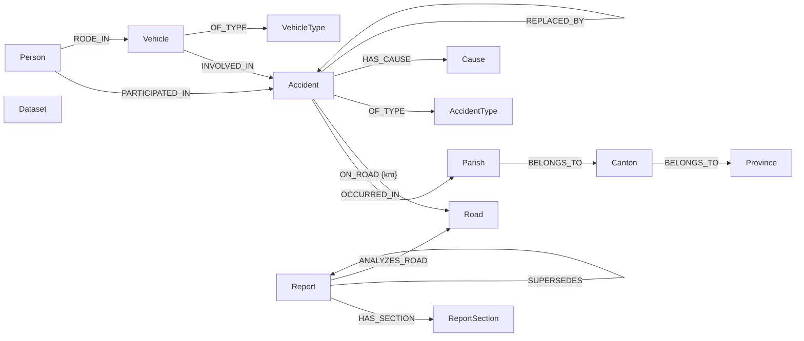

# Modelo de grafo

- **Tarea:** 2.1 del plan. Valida y ajusta la propuesta de la seccion 6 de `docs/PLAN_DESARROLLO.md`.
- **Fecha:** 2026-11-15.
- **Base:** Neo4j 5.26 LTS Community (`neo4j:5.26.31-community`).
- **Origen de los datos:** `CleanDataset` (`src/accident_agent/domain/models.py`), producido por el pipeline (tarea 2.2) con las reglas de `docs/datos/reglas_normalizacion.md`.
- **Convencion:** etiquetas, relaciones y propiedades en ingles; valores canonicos en espanol.

## Indice

1. Criterio nodo, relacion o propiedad
2. Diagrama
3. Nodos
4. Relaciones
5. Restricciones e indices
6. Justificacion campo por campo
7. Cambios respecto a la propuesta del plan
8. Alternativas descartadas
9. Consultas Cypher de ejemplo

## 1. Criterio nodo, relacion o propiedad

- **Nodo:** lo que se comparte entre siniestros y se usa para recorrer o agregar (provincia, via, tipo, causa), o lo que tiene atributos propios (vehiculo, persona, informe).
- **Relacion:** el vinculo entre dos entidades. Lleva propiedades solo si describen el vinculo y no a uno de los extremos (`ON_ROAD.km`: la posicion del siniestro en esa via).
- **Propiedad:** lo que describe a un solo nodo y no se recorre. Clima, superficie e iluminacion son propiedades indexables: tienen 3 o 4 valores, no tienen atributos propios y como nodos solo anadirian saltos.
- **Sin duplicar datos:** cada hecho vive en un solo lugar del grafo. Los conteos de victimas se guardan en `Accident` porque se calculan una vez en la carga y evitan agregaciones en cada consulta.
- **Sin datos personales:** no hay propiedades para nombre, cedula ni placa (politica P1). Personas y vehiculos usan ids sinteticos.

## 2. Diagrama



`Dataset` es un nodo unico y aislado con la procedencia de la carga.

## 3. Nodos

| Etiqueta | Clave | Propiedades | Cantidad esperada |
| --- | --- | --- | --- |
| `Accident` | `accident_id` (`SIN-AAAA-NNNN`) | `version`, `versions_count`, `status`, `is_active`, `occurred_at`, `date`, `year`, `month`, `hour`, `updated_at`, `damages_usd`, `deaths`, `injured`, `unharmed`, `summary_mismatch`, `narrative`, `latitude`, `longitude`, `weather`, `surface`, `lighting`, `annulment_reason` | 30 |
| `Province` | `name` | - | 17 |
| `Canton` | `canton_id` (`<provincia>\|<canton>`) | `name` | 22 |
| `Parish` | `parish_id` (`<provincia>\|<canton>\|<parroquia>`) | `name` | 30 (29 nombres: hay dos `San Rafael`) |
| `Road` | `name` | `code` (E35, E45, E15 o null) | 20 |
| `AccidentType` | `code` | `name`, `definition` (texto de INF-2026-02) | 5 |
| `Cause` | `code` | `name` | 10 |
| `VehicleType` | `code` | `name` | 10 |
| `Vehicle` | `vehicle_id` (`<accident_id>-V<n>`) | `brand`, `model`, `year`, `service` | 49 |
| `Person` | `person_id` (`<accident_id>-P<n>`) | `role`, `age`, `sex`, `condition`, `alcohol_gl`, `protection`, `days_until_death` | 80 |
| `Report` | `report_id` (`INF-AAAA-NN`) | `title`, `date`, `status`, `classification` | 4 |
| `ReportSection` | `section_id` (`<report_id>-S<n>`) | `order`, `title`, `text` | 9 |
| `Dataset` | `sha256` | `source_file`, `source`, `generated`, `schema_version`, `timezone` | 1 |

- Las cantidades salen de la carga real (tarea 2.6). Vehiculos y personas son los de los 30 siniestros cargados: la version 1 de SIN-2025-0007 no se carga.
- `name` de `AccidentType`, `Cause` y `VehicleType` es el codigo legible: `perdida_de_pista` -> `Perdida de pista`.
- Todos los tipos y causas del catalogo se crean aunque no tengan siniestros (hoy todos tienen), para que las consultas por un valor valido devuelvan cero y no "valor desconocido".

## 4. Relaciones

| Relacion | Origen -> destino | Propiedades | Cardinalidad |
| --- | --- | --- | --- |
| `OCCURRED_IN` | `Accident` -> `Parish` | - | Exactamente 1 por siniestro |
| `BELONGS_TO` | `Parish` -> `Canton`, `Canton` -> `Province` | - | Exactamente 1 |
| `ON_ROAD` | `Accident` -> `Road` | `km` (float o null) | Exactamente 1 por siniestro |
| `OF_TYPE` | `Accident` -> `AccidentType`, `Vehicle` -> `VehicleType` | - | Exactamente 1 |
| `HAS_CAUSE` | `Accident` -> `Cause` | - | Exactamente 1 |
| `REPLACED_BY` | `Accident` (anulado) -> `Accident` (vigente) | - | 0 o 1; hoy SIN-2026-0010 -> SIN-2026-0011 |
| `INVOLVED_IN` | `Vehicle` -> `Accident` | - | 1 o mas vehiculos por siniestro |
| `PARTICIPATED_IN` | `Person` -> `Accident` | - | 1 o mas personas por siniestro |
| `RODE_IN` | `Person` -> `Vehicle` | - | 0 o 1; no existe para peatones |
| `HAS_SECTION` | `Report` -> `ReportSection` | - | 1 o mas |
| `SUPERSEDES` | `Report` (nuevo) -> `Report` (reemplazado) | - | 0 o 1; hoy INF-2026-01 -> INF-2025-01 |
| `ANALYZES_ROAD` | `Report` -> `Road` | - | 0 o 1; hoy los 2 informes de la E35 |

## 5. Restricciones e indices

| Tipo | Definicion | Motivo |
| --- | --- | --- |
| Unicidad | Clave de cada etiqueta de la seccion 3 | Integridad y busqueda por clave (crea un indice) |
| Rango | `Accident.occurred_at`, `Accident.date`, `Accident.is_active` | Filtros por fecha ("ultimos 6 meses") y exclusion de anulados |
| Rango | `Accident.weather`, `Accident.surface`, `Accident.lighting` | Filtros por condiciones |
| Full-text | `accident_narratives` sobre `Accident.narrative`, analizador `spanish` | Busqueda en narrativas (`text` de `search_accidents`) |
| Full-text | `report_texts` sobre `ReportSection.title` y `ReportSection.text`, analizador `spanish` | Busqueda en informes (`mode=reports`) |

Todas se crean con `IF NOT EXISTS` y en una transaccion separada de los datos (Neo4j no mezcla esquema y datos en una transaccion).

## 6. Justificacion campo por campo

La correspondencia completa entre campo original y regla esta en `docs/datos/reglas_normalizacion.md`, seccion 5. Aqui se justifica la forma en el grafo.

| Campo original | En el grafo | Forma | Por que |
| --- | --- | --- | --- |
| `id_parte` | `Accident.accident_id` | Clave | Identificador citado en respuestas e informes |
| `version`, `fecha_actualizacion` | `Accident.version`, `versions_count`, `updated_at` | Propiedades | Trazabilidad de la version cargada (R01); no se consultan como dimension |
| `estado` | `Accident.status`, `is_active` | Propiedades (indice en `is_active`) | Filtro presente en casi toda consulta; un booleano indexado es mas barato que comparar textos |
| `fecha_hora` | `occurred_at`, `date`, `year`, `month`, `hour` | Propiedades | Los derivados permiten agrupar por mes o anio sin funciones en cada consulta; la fecha no se comparte entre siniestros, no es nodo |
| `ubicacion.provincia`, `canton`, `parroquia` | `Province`, `Canton`, `Parish` | Nodos en jerarquia | Dimension compartida que se recorre y se agrega ("siniestros en Pichincha") |
| `ubicacion.via` | `Road` | Nodo | Compartida por varios siniestros y analizada por informes (`ANALYZES_ROAD`) |
| `ubicacion.km` | `ON_ROAD.km` | Propiedad de relacion | Es la posicion del siniestro en esa via: describe el vinculo, no al siniestro ni a la via |
| `ubicacion.coordenadas` | `Accident.latitude`, `longitude` | Propiedades | Referenciales (INF-2026-02); no se hacen calculos espaciales |
| `tipo_siniestro` | `AccidentType` | Nodo | Dimension con atributo propio (`definition` de INF-2026-02) |
| `causa_probable` | `Cause` | Nodo | Dimension para filtrar y agregar ("principal causa") |
| `condiciones.*` | `Accident.weather`, `surface`, `lighting` | Propiedades indexadas | 3 o 4 valores sin atributos propios (seccion 1) |
| `danos_materiales` | `Accident.damages_usd` | Propiedad | Medida numerica del siniestro |
| `resumen` | `Accident.deaths`, `injured`, `unharmed`, `summary_mismatch` | Propiedades derivadas | Conteos calculados de las personas (R03); el resumen declarado solo marca la inconsistencia |
| `narrativa` | `Accident.narrative` | Propiedad con indice full-text | Texto del siniestro para el RAG; dato no confiable (SIN-2026-0009) |
| `motivo_anulacion`, `reemplaza_a` | `Accident.annulment_reason`, `REPLACED_BY` | Propiedad y relacion | El reemplazo vincula dos siniestros; recorrerlo responde "que paso con SIN-2026-0010" |
| `vehiculos[]` | `Vehicle`, `VehicleType` | Nodos | El vehiculo tiene atributos propios y se vincula con personas; el tipo es dimension ("siniestros con motocicletas") |
| `vehiculos[].placa` | - | No se carga | Dato personal; solo enlaza persona y vehiculo durante la carga (R04) |
| `personas[]` | `Person` | Nodo | Atributos propios y vinculo con su vehiculo; sin nombre ni cedula |
| `personas[].rol`, `condicion` | `Person.role`, `condition` | Propiedades del nodo | Una persona participa en un solo siniestro, asi que el rol en la relacion repetiria el dato |
| `informes[]` | `Report`, `ReportSection` | Nodos | El informe es la fuente documental; las secciones son la unidad de texto que se indexa y se cita |
| `informes[].reemplaza_a`, `via_analizada` | `SUPERSEDES`, `ANALYZES_ROAD` | Relaciones | Permiten priorizar el informe vigente y llegar a los informes de una via |
| `metadata` | `Dataset` | Nodo unico | Procedencia (fuente, SHA-256) que los informes generados citan |
| `fuente` del registro | - | No se carga | Constante en los 31 registros |

## 7. Cambios respecto a la propuesta del plan

| Propuesta (seccion 6 del plan) | Modelo final | Motivo |
| --- | --- | --- |
| `km` en `Accident` y en `ON_ROAD` | Solo en `ON_ROAD` | Evitar el dato duplicado; es la posicion en la via |
| `PARTICIPATED_IN {role, condition}` | Sin propiedades; `role` y `condition` en `Person` | Evitar el dato duplicado; la persona pertenece a un solo siniestro |
| Canton y parroquia "con clave compuesta" | `canton_id` y `parish_id` sinteticos | Una sola propiedad unica; el nombre solo no es unico: hay dos parroquias `San Rafael` (Otavalo y Ruminahui), y `Santa Elena` es canton y provincia |
| `VehicleType` con clave `name` | Clave `code` y `name` legible | Mismo patron que `AccidentType` y `Cause` |
| `ReportSection` con clave "report_id y orden" | `section_id` (`<report_id>-S<n>`) | Clave de una sola propiedad |
| Sin nodo de procedencia | `Dataset` | La fuente y el SHA-256 se citan en los informes y prueban que el grafo viene del archivo verificado |
| Full-text solo sobre `ReportSection.text` | `title` y `text`, analizador `spanish` | Los titulos tambien orientan la busqueda; el analizador reduce plurales y variaciones |

## 8. Alternativas descartadas

- **Clima, superficie e iluminacion como nodos:** sin atributos propios y con 3 o 4 valores; solo anadirian saltos (seccion 1).
- **Fecha como nodo (arbol de tiempo `Year`-`Month`-`Day`):** util con millones de eventos; con 30 siniestros, las propiedades indexadas bastan.
- **Persona compartida entre siniestros:** imposible sin cedula y no deseable (A26, politica P2).
- **Busqueda vectorial o embeddings:** fuera de alcance (seccion 1 del plan); el full-text cubre las narrativas y los informes.
- **Un solo indice full-text para narrativas e informes:** se separan para que `mode=reports` no devuelva narrativas y para aplicar pesos distintos en el futuro.

## 9. Consultas Cypher de ejemplo

Todas son de solo lectura y parametrizadas. Los resultados reales se guardan en la tarea 2.8 (`docs/evidencias/2.8_consultas_ejemplo.txt`).

**Siniestros vigentes por provincia** (valor de control: Pichincha 5, Guayas 5):

```cypher
MATCH (a:Accident {is_active: true})-[:OCCURRED_IN]->(:Parish)-[:BELONGS_TO]->(:Canton)
      -[:BELONGS_TO]->(p:Province)
RETURN p.name AS province, count(a) AS accidents
ORDER BY accidents DESC, province
```

**Siniestros con fallecidos en una via** (`$road_code = 'E35'`; control: 4):

```cypher
MATCH (a:Accident {is_active: true})-[r:ON_ROAD]->(road:Road {code: $road_code})
WHERE a.deaths > 0
RETURN a.accident_id, a.date, a.deaths, r.km
ORDER BY a.date
```

**Siniestros con un tipo de vehiculo** (`$vehicle_type = 'motocicleta'`; control: 7):

```cypher
MATCH (a:Accident {is_active: true})<-[:INVOLVED_IN]-(:Vehicle)-[:OF_TYPE]->(:VehicleType {code: $vehicle_type})
RETURN count(DISTINCT a) AS accidents
```

**Siniestros en un rango de fechas** (`$date_from = date('2026-05-15')`, `$date_to = date('2026-11-15')`; escenario 5):

```cypher
MATCH (a:Accident {is_active: true})
WHERE a.date >= $date_from AND a.date <= $date_to
RETURN a.accident_id, a.date
ORDER BY a.date
```

**Trazabilidad de un anulado** (`$accident_id = 'SIN-2026-0010'`; escenario 12):

```cypher
MATCH (a:Accident {accident_id: $accident_id})
OPTIONAL MATCH (a)-[:REPLACED_BY]->(r:Accident)
RETURN a.accident_id, a.status, a.annulment_reason, r.accident_id AS replaced_by
```

**Busqueda en narrativas** (`$text = 'neblina'`):

```cypher
CALL db.index.fulltext.queryNodes('accident_narratives', $text) YIELD node, score
WHERE node.is_active
RETURN node.accident_id, score
ORDER BY score DESC
LIMIT 10
```

**Informes vigentes de una via** (`$road_code = 'E35'`; escenario 8):

```cypher
MATCH (rep:Report)-[:ANALYZES_ROAD]->(:Road {code: $road_code})
OPTIONAL MATCH (rep)-[:SUPERSEDES]->(old:Report)
RETURN rep.report_id, rep.status, old.report_id AS supersedes
ORDER BY rep.status = 'vigente' DESC, rep.date DESC
```

**Subgrafo completo de un siniestro** (para la captura de Neo4j Browser). Se enumeran los recorridos para no arrastrar otros siniestros de la misma via o provincia:

```cypher
MATCH (a:Accident {accident_id: $accident_id})
CALL (a) {
  MATCH p = (a)-[:OCCURRED_IN]->()-[:BELONGS_TO]->()-[:BELONGS_TO]->() RETURN p
  UNION
  MATCH p = (a)-[:ON_ROAD|OF_TYPE|HAS_CAUSE|REPLACED_BY]-() RETURN p
  UNION
  MATCH p = (a)<-[:INVOLVED_IN]-()-[:OF_TYPE]->() RETURN p
  UNION
  MATCH p = (a)<-[:PARTICIPATED_IN]-()-[:RODE_IN*0..1]->() RETURN p
}
RETURN p
```
